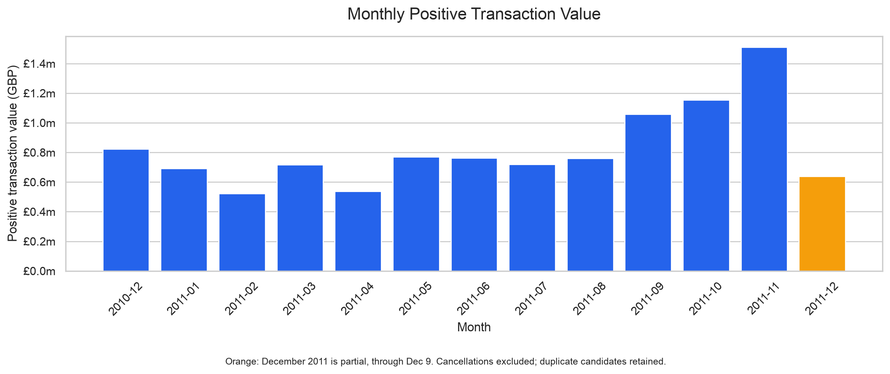
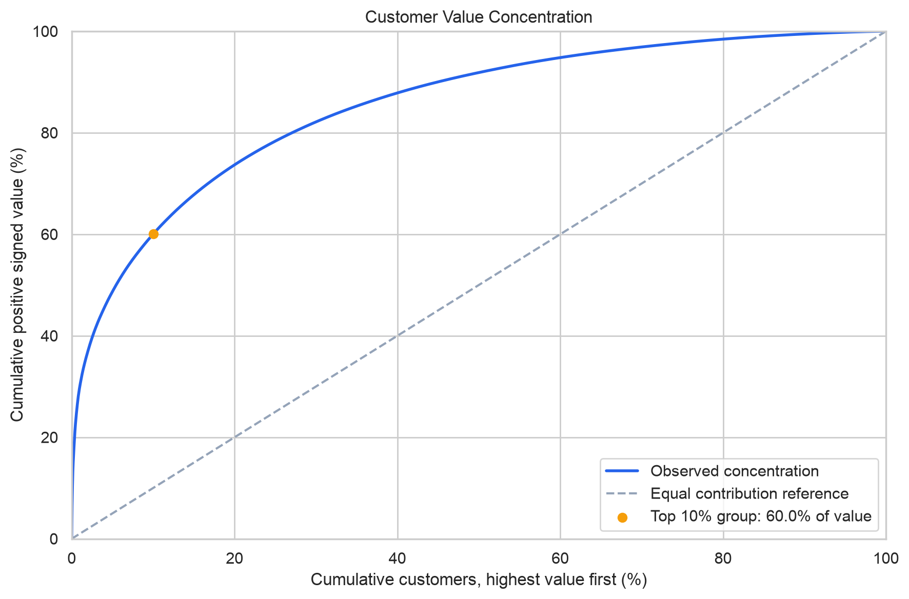
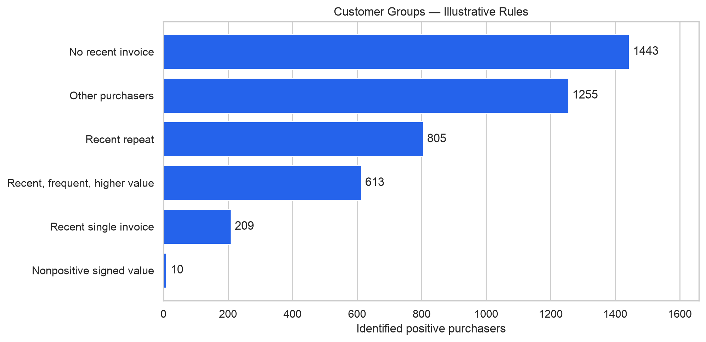

# E-commerce Customer Behavior EDA

An exploratory analysis of retail transactions and customer behavior
using Python and the UCI Online Retail dataset.

## Dataset

The [UCI Online Retail dataset](https://archive.ics.uci.edu/dataset/352/online+retail)
contains 541,909 transaction lines from a UK-based retailer between
December 1, 2010 and December 9, 2011. Amounts are in GBP.

**Citation:** Chen, D. (2015). *Online Retail* [Dataset]. UCI Machine
Learning Repository. https://doi.org/10.24432/C5BW33

**License:** Creative Commons Attribution 4.0 International (CC BY 4.0).

## Key Findings

- November 2011 had the highest full-month positive transaction value:
  **£1,509,496.33**. December 2011 is incomplete.
- The UK accounted for **84.61%** of positive transaction value.
- Among 4,335 identified positive merchandise purchasers, **65.28%**
  had at least two positive invoices during the observation period.
- The top 433 customers contributed **60.05%** of signed value among
  the 4,325 positive-value customers in the purchaser population.
- Thursday averaged **77.98** positive merchandise invoices per
  calendar day. The busiest recorded hour was **12:00–12:59**.
- Large cancellation entries changed product rankings substantially.

## Charts







## Tools

Python, pandas, NumPy, Matplotlib, Seaborn, Jupyter, and VS Code.

## Run Locally

1. Download the dataset from the UCI link above and extract it.
2. Place `Online Retail.xlsx` in `data/raw/`.
3. From the project root, create an environment and install dependencies:

   ```bash
   python3 -m venv .venv
   source .venv/bin/activate
   python -m pip install -r requirements.txt
   ```

4. Open `notebooks/01_retail_eda.ipynb` in VS Code.
5. Select the `.venv` kernel and choose **Run All**.

The notebook saves analysis tables to `data/processed/` and figures to
`reports/figures/`. The original workbook is excluded from Git.

## Methods and Limitations

- Positive transaction value includes positive quantities and prices,
  including charges and entries that may later be cancelled.
- Signed merchandise value includes negative quantities at positive
  prices. The list of excluded non-merchandise codes is provisional.
- CustomerID is missing in 24.93% of original rows. Customer analyses
  include identified customers only.
- Duplicate candidates are retained; excluding them reduces positive
  transaction value by approximately 0.23%.
- Repeat-invoice share is descriptive, not a retention rate. Positive
  invoices may later be cancelled.
- Customer groups use illustrative thresholds, not validated predictions.
- The results describe one historical retailer and do not measure profit
  or establish causality.

## Author

Rashmi Thimmaraju · [GitHub](https://github.com/Rashmioffcialpage)